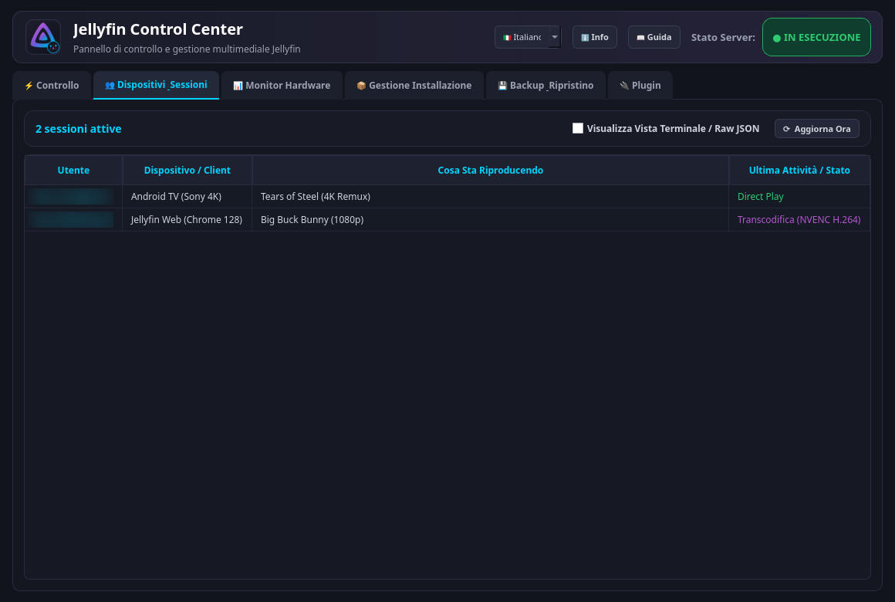
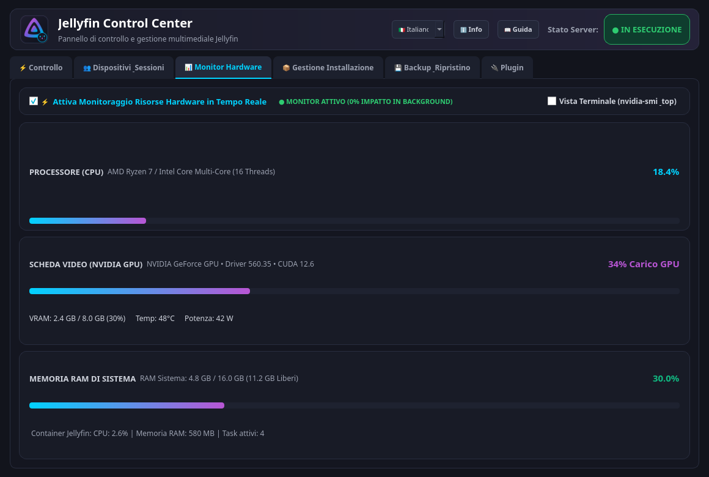
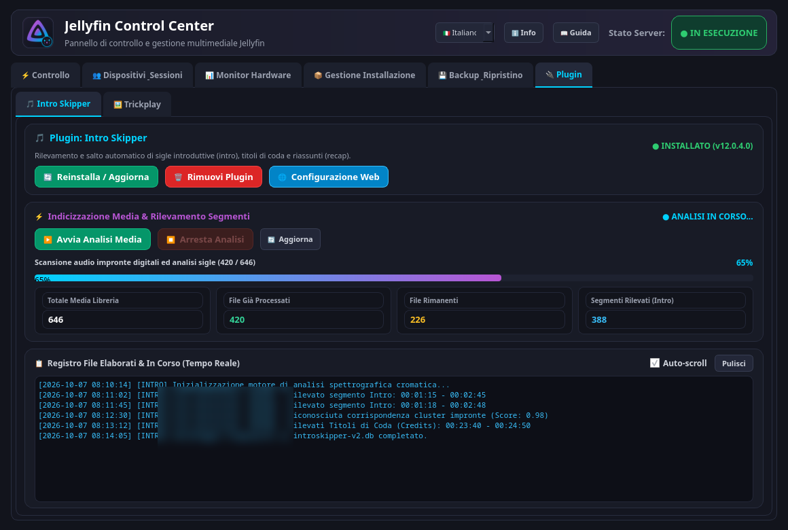
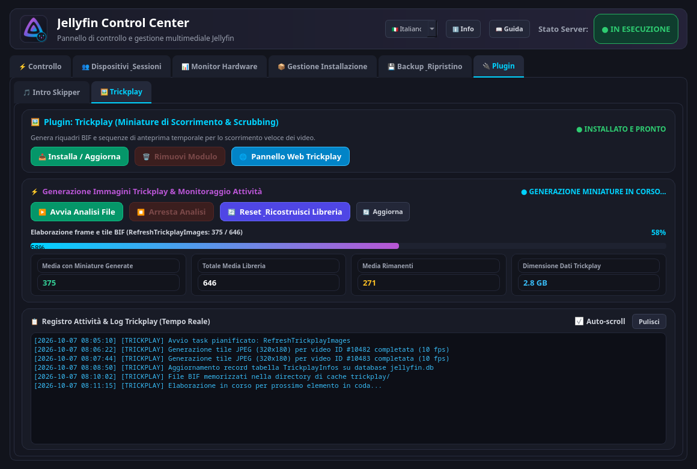
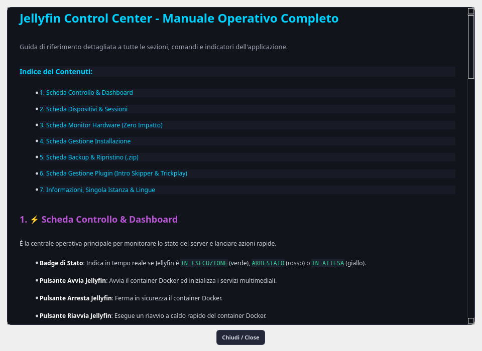
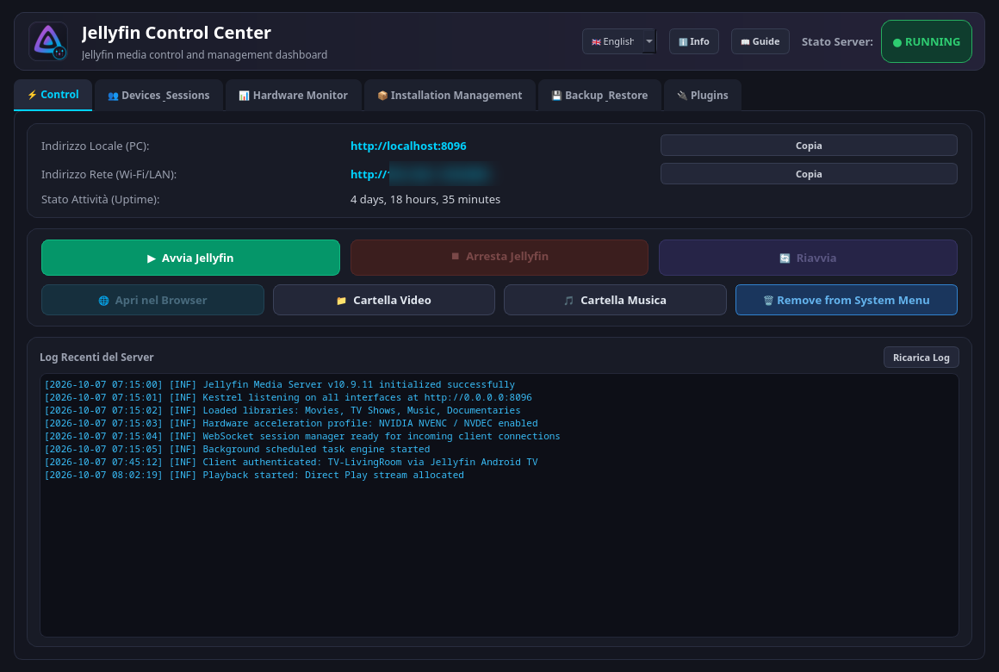
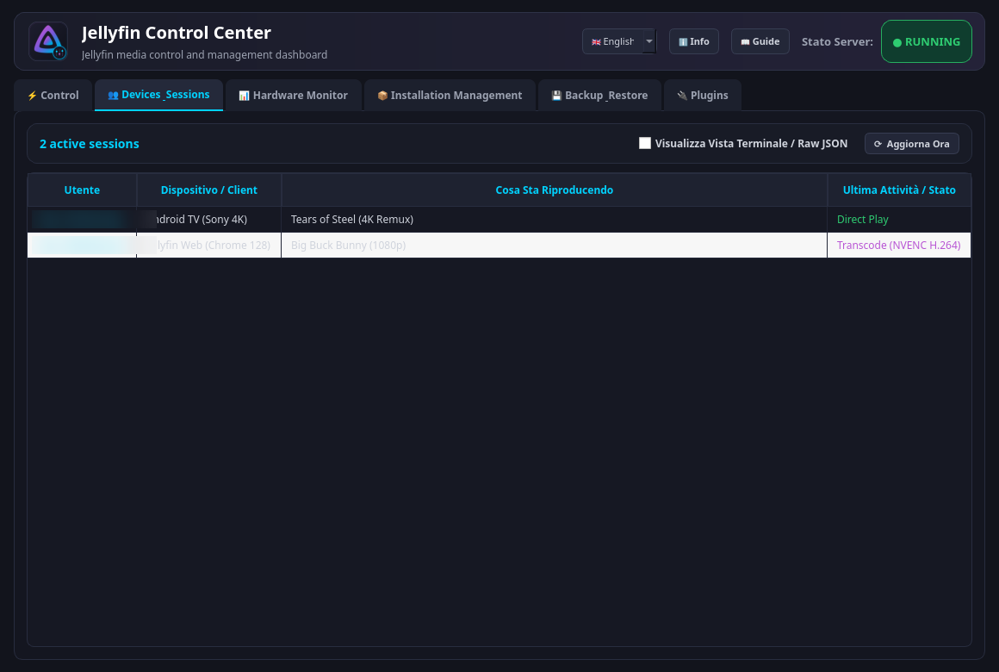
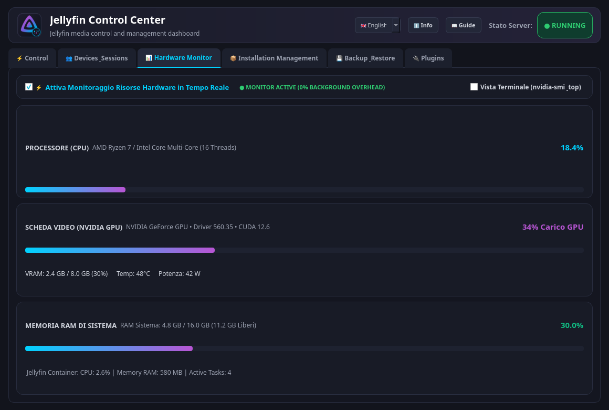
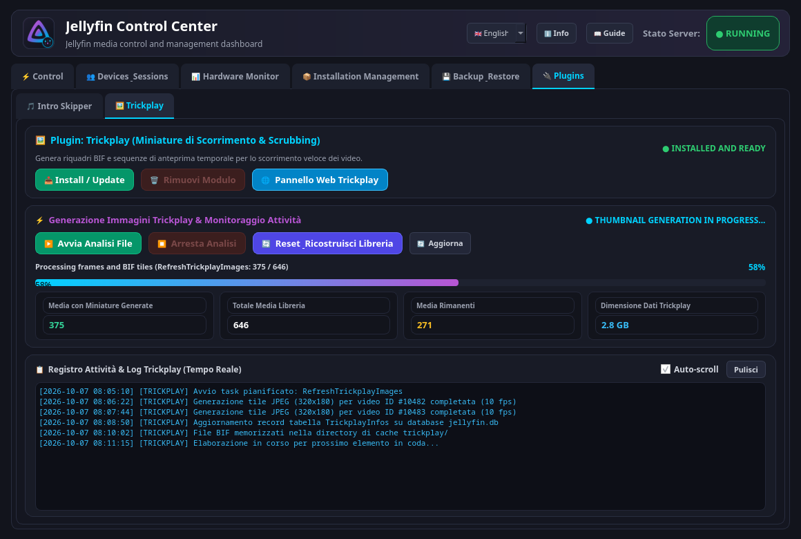
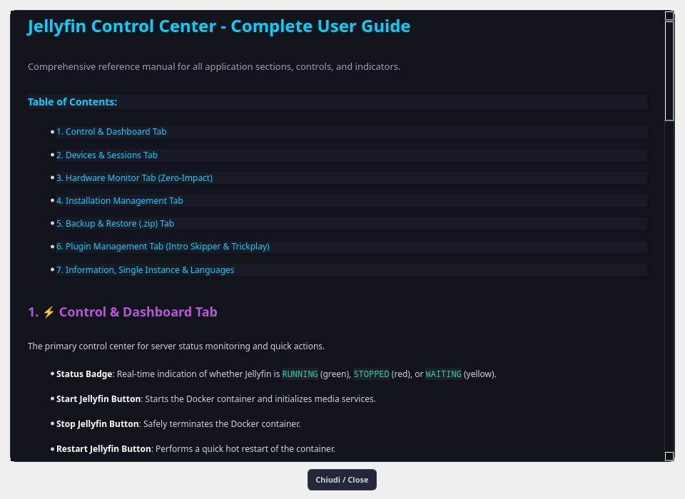

# Jellyfin Control Center 🎬🚀

[](https://github.com)
[](https://python.org)
[](https://riverbankcomputing.com/software/pyqt/)
[](LICENSE)
[](https://github.com)

> **💡 Idea & Visione:** *Nato da un'idea e visione di PsyTech76*  
> Sviluppato e ingegnerizzato con il supporto dell'Intelligenza Artificiale (DeepMind / Antigravity) e PyQt6.

---

## 🇮🇹 Italiano

**Jellyfin Control Center** è una suite grafica completa, moderna e reattiva progettata per gestire, monitorare e manutenere un server multimediale **Jellyfin** su qualsiasi sistema Linux (sia in container Docker che con installazione nativa).

### ✨ Caratteristiche Principali

1. **🌐 Compatibilità Universale Multi-Utente & Multi-Distro:**
   - Progettato per qualsiasi utente e sistema Linux: zero percorsi cablati, risoluzione dinamica della home directory (`~`) e dell'ambiente di lavoro.
2. **📌 Integrazione di Sistema con un Clic (Desktop XDG):**
   - Pulsante dedicato per abilitare o disabilitare l'applicazione come app di sistema. Registra automaticamente il lanciatore `.desktop` e l'icona in `~/.local/share/applications/`, rendendola reperibile nella ricerca delle applicazioni e pronta per essere fissata alla barra delle applicazioni o al dock.
3. **🔒 Istanza Singola in Runtime (Single-Instance):**
   - Meccanismo IPC basato su socket locale che impedisce aperture multiple accidentali, riportando elegantemente in primo piano la finestra attiva.
4. **📊 Monitoraggio Hardware "On-Demand":**
   - Misurazione in tempo reale di CPU, RAM e GPU (NVIDIA `nvidia-smi`, AMD `amdgpu`, Intel `intel_gpu_top`).
   - Si attiva **esclusivamente** quando la scheda è visibile, garantendo **impatto computazionale zero** durante il normale utilizzo in background.
5. **👥 Gestione Utenti & Sessioni Attive:**
   - Tabella interattiva che mostra utenti connessi, dispositivi/client, titolo del media attualmente in riproduzione, metodo di transcodifica/direct play e durata della sessione.
6. **⚙️ Installazione e Disinstallazione Guidata:**
   - Rilevamento automatico della distribuzione Linux (Debian, Ubuntu, Arch/CachyOS, Fedora, openSUSE).
   - Configurazione autonoma dei repository ufficiali o installazione Docker.
   - Rimozione completa e atomica senza file residui.
7. **💾 Backup e Ripristino Dati Utente (.zip):**
   - Creazione di snapshot compressi completi della configurazione e dei dati Jellyfin.
   - Ripristino sicuro con verifica di integrità ed arresto temporaneo del servizio.
8. **🔌 Sezione Plugin Avanzata:**
   - **🎵 Intro Skipper:** Installazione, rimozione, avvio/arresto scansione delle intro e monitoraggio in tempo reale dei media analizzati e log dettagliati.
   - **🖼️ Trickplay:** Verifica preventiva dell'installazione, scansione fotogrammi trickplay (Start/Stop), monitoraggio del task `RefreshTrickplayImages`, reset e ricostruzione completa della libreria da zero, e pulsante diretto al pannello web del plugin.
9. **🌍 Localizzazione a 5 Lingue:**
   - Italiano, Inglese, Francese, Tedesco e Spagnolo. Rilevamento automatico della lingua di sistema con fallback in Inglese e commutazione istantanea a runtime.
10. **📖 Guida Utente HTML Integrata:**
    - Manuale grafico integrato in finestra separata che spiega visivamente ogni sezione, pulsante e indicatore dell'applicazione.

---

### 📸 Anteprime dell'Applicazione (Screenshot)

> [!NOTE]
> Per garantire la massima riservatezza e conformità alla privacy, tutti i dati sensibili (indirizzi IP di rete locale, nomi utente e percorsi dei file multimediali) sono stati offuscati/sfocati.

#### 1. Dashboard & Controllo Servizio
*Monitoraggio dello stato del server Jellyfin (Nativo o Docker), avvio/arresto/riavvio, URL locale e abilitazione come app di sistema con un clic.*


#### 2. Dispositivi & Sessioni Attive
*Rilevamento in tempo reale delle sessioni di streaming, client connessi, titoli in riproduzione e codec di transcodifica.*


#### 3. Monitor Hardware a Impatto Zero
*Telemetria istantanea per CPU, RAM e GPU (NVIDIA / AMD / Intel), attiva solo a scheda visibile.*


#### 4. Gestione Plugin: Intro Skipper
*Installazione con un clic, indicizzazione delle intro dei media, avanzamento e log temporizzato dei file elaborati.*


#### 5. Gestione Plugin: Trickplay
*Generazione fotogrammi BIF/Trickplay, monitoraggio del task di background, ricostruzione libreria e link diretto alla configurazione web.*


#### 6. Guida Utente HTML Integrata
*Finestra separata con il manuale multilingua completo per consultare il funzionamento di ogni opzione del programma.*


---

### 🚀 Come Avviare l'Applicazione

#### Opzione 1: AppImage Autonoma (Consigliata)
Non richiede installazione né dipendenze esterne.
```bash
chmod +x Jellyfin_Control_Center-x86_64.AppImage
./Jellyfin_Control_Center-x86_64.AppImage
```

#### Opzione 2: Esecuzione da Codice Sorgente
Assicurati di avere Python 3.10+ e le dipendenze richieste:
```bash
pip install -r requirements.txt
python3 src/jellyfin_manager.py
```

---

<br/>

## 🇬🇧 English

**Jellyfin Control Center** is a modern, responsive, and full-featured desktop management GUI for **Jellyfin Media Server** running on Linux (both Docker container and bare-metal installations).

### ✨ Key Features

1. **🌐 Universal Multi-User & Multi-Distro Support:**
   - Designed for any user and environment: zero hardcoded paths, dynamic home directory (`~`) resolution and portable design.
2. **📌 One-Click Desktop System Integration (XDG Standard):**
   - Built-in button to easily integrate or remove the application from your desktop environment. Automatically configures `.desktop` launchers and high-resolution icons in `~/.local/share/applications/`, making it searchable in app menus and pinnable to docks or taskbars.
3. **🔒 Runtime Single-Instance:**
   - Built-in local IPC socket mechanism that prevents duplicate instances, smoothly bringing the active window to focus.
4. **📊 On-Demand Hardware Monitoring:**
   - Real-time CPU, RAM, and GPU (NVIDIA, AMD, Intel) statistics.
   - Operates **strictly** when the Hardware tab is visible—zero background compute overhead when navigating other sections.
5. **👥 Active Users & Live Sessions:**
   - Interactive table detailing connected users, device types, currently playing titles, playback method (Direct Play / Transcode), and active session duration.
6. **⚙️ Automated Installation & Clean Removal:**
   - Auto-detects Linux distribution (Debian, Ubuntu, Arch/CachyOS, Fedora, openSUSE).
   - Seamless repository/Docker setup and clean atomic uninstallation.
7. **💾 User Data Backup & Restore (.zip):**
   - Full compressed snapshots of Jellyfin user data and configurations with progress tracking and safe rollback.
8. **🔌 Dedicated Plugin Management:**
   - **🎵 Intro Skipper:** Install, uninstall, start/stop intro detection, real-time counters, and timestamped log stream.
   - **🖼️ Trickplay:** Pre-install check, frame generation control (Start/Stop), live task tracking (`RefreshTrickplayImages`), full library reset and rebuild from scratch, plus one-click web settings launcher.
9. **🌍 5-Language Localization:**
   - Italian, English, French, German, and Spanish. Auto-detects OS locale with English fallback and live runtime switcher.
10. **📖 Integrated HTML User Guide:**
    - Dedicated standalone documentation window detailing every control and workflow.

---

### 📸 Application Previews (Screenshots)

> [!NOTE]
> To preserve privacy and security, all sensitive information (LAN IP addresses, user account names, and media file paths) has been blurred.

#### 1. Dashboard & Service Control
*Real-time server state (Native or Docker), service start/stop/restart, LAN access URL, and one-click XDG desktop integration.*


#### 2. Devices & Live Sessions
*Live tracking of active streaming sessions, connected client devices, current playback titles, and transcode codecs.*


#### 3. Zero-Impact Hardware Monitor
*Instant telemetry gauges for CPU, RAM, and GPU load (NVIDIA / AMD / Intel), active only while the tab is open.*


#### 4. Plugin Management: Intro Skipper
*One-click installation, intro indexing trigger, real-time file counters, and timestamped progress log.*


#### 5. Plugin Management: Trickplay
*BIF/Trickplay frame generation, live background task tracking, clean library rebuild, and direct web config access.*


#### 6. Integrated HTML User Guide
*Standalone multilingual user manual window explaining each control and workflow within the interface.*


---

### 🚀 Getting Started

#### Option 1: Standalone AppImage (Recommended)
Download the latest AppImage from the [Releases](https://github.com) section:
```bash
chmod +x Jellyfin_Control_Center-x86_64.AppImage
./Jellyfin_Control_Center-x86_64.AppImage
```

#### Option 2: Run from Source
```bash
git clone https://github.com/PsyTech1976/Jellyfin-Control-Center.git
cd Jellyfin-Control-Center
pip install -r requirements.txt
python3 src/jellyfin_manager.py
```

---

### 📜 Credits & License
- **Conception & Vision:** Created from an idea and vision of **PsyTech76**.
- **Engineering:** Developed with AI pair programming (DeepMind / Antigravity) & PyQt6.
- **License:** Open Source under GPL v3 / MIT compatible terms.
